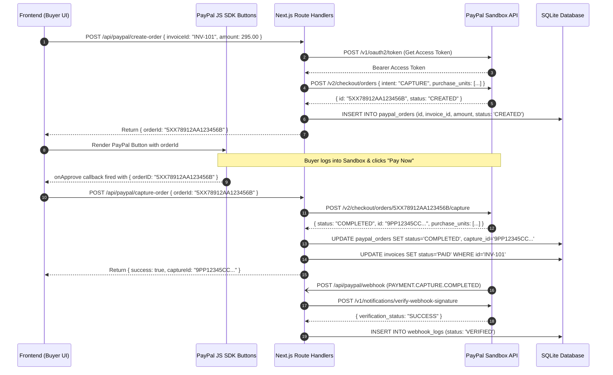

# 07 — PayPal Orders API v2 Integration Blueprint: BorderBrief AI

**Document ID:** BB-RES-007  
**API Specification:** PayPal REST API v2 (Checkout / Orders) & v1 (Webhooks Management)  
**Environment:** PayPal Developer Sandbox (`https://api-m.sandbox.paypal.com`)  
**SDK Package:** `@paypal/react-paypal-js` (Official React wrapper for PayPal JS SDK)  
**Status:** Approved for Architecture Design (Research Phase)

---

## 1. Why PayPal Integration is Central to BorderBrief AI

In cross-border trade between Indian micro-exporters and US buyers, payment friction is high:
- Indian sellers lack US merchant banking accounts.
- US buyers are reluctant to send international bank wire transfers (SWIFT) to unknown individual accounts in India.
- Foreign exchange regulations in India (FEMA) require formal inward remittance certificates (e-FIRC).

Integrating **PayPal Orders API v2** closes the loop:
1. BorderBrief AI prepares the shipment compliance profile, HTS classification, and landed cost.
2. The platform generates a commercial invoice in USD.
3. The seller generates a direct PayPal checkout request that includes the verified invoice reference.
4. The US buyer pays securely in USD using PayPal, Venmo, credit cards, or Pay Later.
5. Payment is captured and reconciled against the export invoice record on the server.

---

## 2. Sandbox Setup & Credential Management

### 2.1 Developer Sandbox Provisioning
1. Sign in to the [PayPal Developer Dashboard](https://developer.paypal.com/) (Free, no credit card required).
2. Under **Apps & Credentials**, select the **Sandbox** toggle and create an App named `BorderBrief-Sandbox`.
3. Obtain:
   - `PAYPAL_CLIENT_ID`: Publicly safe to pass to frontend SDK.
   - `PAYPAL_CLIENT_SECRET`: Private server-side secret; stored strictly in `.env.local`.
4. Under **Sandbox Accounts**, review automatically generated test accounts:
   - **Seller (Business) Account:** Represents the Indian exporter's receiving account (simulated business profile).
   - **Buyer (Personal) Account:** Represents the US customer with a simulated \$5,000 USD balance and pre-linked test credit cards.

### 2.2 Cost Analysis: Sandbox vs Production
- **Sandbox Environment:** **$0.00 / ₹0.00** transaction fees. Unlimited test orders and captures.
- **Production Commercial Cross-Border Fees (India Exporters receiving USD):**
  - Standard PayPal international transaction fee: **4.4% + fixed fee ($0.30 USD)** per transaction.
  - Foreign exchange currency conversion spread: Typically **3.0% to 4.0%** above wholesale exchange rates upon withdrawal to an Indian bank account via RBI OPGSP guidelines.
  - *Product Transparency:* BorderBrief AI can optionally show sellers estimated PayPal receiving fees so they understand net INR proceeds after export.

---

## 3. The 4-Step Checkout Lifecycle



---

## 4. Exact API Endpoints & Request Payloads

### 4.1 Step 1: OAuth2 Token Generation
Before making server-to-server calls, the Next.js Route Handler retrieves a temporary bearer token:
- **Endpoint:** `POST https://api-m.sandbox.paypal.com/v1/oauth2/token`
- **Headers:**
  - `Authorization: Basic base64(PAYPAL_CLIENT_ID:PAYPAL_CLIENT_SECRET)`
  - `Content-Type: application/x-www-form-urlencoded`
- **Body:** `grant_type=client_credentials`

### 4.2 Step 2: Create Order
- **Endpoint:** `POST https://api-m.sandbox.paypal.com/v2/checkout/orders`
- **Headers:**
  - `Authorization: Bearer <ACCESS_TOKEN>`
  - `Content-Type: application/json`
- **Payload:**
```json
{
  "intent": "CAPTURE",
  "purchase_units": [
    {
      "reference_id": "REF_INV_101",
      "custom_id": "BB_EXPORT_RECORD_01J8",
      "description": "Export Shipment: 10x Handmade Cotton Tote Bags (US HTS 4202.92.15.00)",
      "amount": {
        "currency_code": "USD",
        "value": "295.00",
        "breakdown": {
          "item_total": {
            "currency_code": "USD",
            "value": "250.00"
          },
          "shipping": {
            "currency_code": "USD",
            "value": "45.00"
          },
          "tax_total": {
            "currency_code": "USD",
            "value": "0.00"
          }
        }
      },
      "items": [
        {
          "name": "Handmade Cotton Tote Bag",
          "unit_amount": {
            "currency_code": "USD",
            "value": "25.00"
          },
          "quantity": "10",
          "category": "PHYSICAL_GOODS"
        }
      ]
    }
  ],
  "application_context": {
    "brand_name": "BorderBrief Exporter Portal",
    "landing_page": "NO_PREFERENCE",
    "user_action": "PAY_NOW",
    "shipping_preference": "GET_FROM_FILE"
  }
}
```

### 4.3 Step 3: Capture Order
- **Endpoint:** `POST https://api-m.sandbox.paypal.com/v2/checkout/orders/{id}/capture`
- **Headers:**
  - `Authorization: Bearer <ACCESS_TOKEN>`
  - `Content-Type: application/json`
- **Payload:** `{}` *(Empty JSON object)*
- **Response Verification:**
  - Check `response.status === "COMPLETED"`.
  - Extract `captureId = response.purchase_units[0].payments.captures[0].id`.
  - Extract payer email: `response.payer.email_address`.

---

## 5. Webhook Signature Verification

Never trust an incoming webhook event without cryptographic verification. PayPal uses asymmetric RSA signatures.

- **Endpoint:** `POST https://api-m.sandbox.paypal.com/v1/notifications/verify-webhook-signature`
- **Verification Payload:**
```json
{
  "auth_algo": "Header[PAYPAL-AUTH-ALGO]",
  "cert_url": "Header[PAYPAL-CERT-URL]",
  "transmission_id": "Header[PAYPAL-TRANSMISSION-ID]",
  "transmission_sig": "Header[PAYPAL-TRANSMISSION-SIG]",
  "transmission_time": "Header[PAYPAL-TRANSMISSION-TIME]",
  "webhook_id": "ENV[PAYPAL_WEBHOOK_ID]",
  "webhook_event": "<RAW_INCOMING_JSON_BODY>"
}
```
- **Handling Result:**
  - If `verification_status === "SUCCESS"`, log the event and reconcile database status.
  - If `verification_status !== "SUCCESS"`, respond with HTTP `400 Bad Request` and reject the event.

---

## 6. Frontend Integration: `@paypal/react-paypal-js`

The frontend uses the official PayPal React SDK for clean button rendering:

```tsx
import { PayPalScriptProvider, PayPalButtons } from "@paypal/react-paypal-js";

export function PayPalCheckoutButton({ invoiceId, amount }: { invoiceId: string; amount: number }) {
  return (
    <PayPalScriptProvider options={{ 
      clientId: process.env.NEXT_PUBLIC_PAYPAL_CLIENT_ID!,
      currency: "USD",
      intent: "capture"
    }}>
      <PayPalButtons
        style={{ layout: "vertical", shape: "rect", color: "gold" }}
        createOrder={async () => {
          const res = await fetch("/api/paypal/create-order", {
            method: "POST",
            headers: { "Content-Type": "application/json" },
            body: JSON.stringify({ invoiceId, amount })
          });
          const data = await res.json();
          return data.orderId;
        }}
        onApprove={async (data) => {
          const res = await fetch("/api/paypal/capture-order", {
            method: "POST",
            headers: { "Content-Type": "application/json" },
            body: JSON.stringify({ orderId: data.orderID, invoiceId })
          });
          const captureData = await res.json();
          if (captureData.status === "COMPLETED") {
            window.location.href = `/export/${invoiceId}/receipt?captureId=${captureData.captureId}`;
          }
        }}
      />
    </PayPalScriptProvider>
  );
}
```

---

## 7. Security Best Practices Checklist

1. **Client Isolation:** The `PAYPAL_CLIENT_SECRET` is never accessible in browser code. All order creation and capture requests execute in server-side Route Handlers.
2. **Server-Side Price Validation:** The client passes `invoiceId`; the server fetches the canonical price from the SQLite database rather than trusting amounts submitted in the client request body.
3. **Double-Spend Prevention:** Before capturing an order, the server checks if `paypal_orders.status === 'COMPLETED'` to prevent replay attacks.
4. **Idempotency:** Webhook logs record the unique `event_id` to ignore duplicate incoming notifications.

